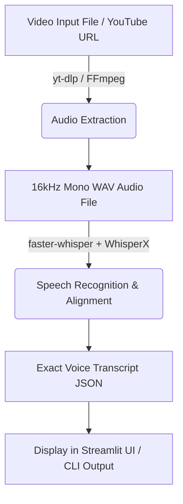

# Video Transcriber System

## Short Description
A robust, advanced Video Transcriber system that extracts the exact voice from video files or YouTube URLs using Whisper transcription. 

---

## Features
- Upload or link lecture videos (YouTube supported)
- Automatic audio extraction via FFmpeg/yt-dlp
- Speech-to-text transcription using Whisper
- Streamlit web UI for an interactive experience
- CLI for terminal usage
- Strict adherence to original voice (no LLM alteration/hallucination)

---

## System Architecture



---

## Technology Stack
- **Python 3.10+**: Core language
- **Streamlit**: Web interface
- **faster-whisper**: High-performance speech-to-text
- **WhisperX**: Forced alignment and punctuation
- **FFmpeg & yt-dlp**: Media processing and downloading

---

## How It Works
1. **Video Upload/Link**: User provides a video file or YouTube URL.
2. **Audio Extraction**: Audio is extracted and converted to a standardized WAV format (16kHz, mono).
3. **Transcription & Alignment**: `faster-whisper` transcribes the audio to text, and `WhisperX` handles forced alignment to capture the exact spoken voice with accurate timestamps.
4. **Display**: The final, unadulterated transcript is displayed directly to the user.

---

## Installation Instructions
1. **Clone the repository:**
   ```bash
   git clone https://github.com/yourusername/video-transcriber.git
   cd video-transcriber
   ```
2. **Set up Python environment:**
   ```bash
   python -m venv my_env
   source my_env/Scripts/activate  # On Windows: my_env\Scripts\activate.bat
   pip install -r requirements.txt
   ```
3. **Install System Dependencies:**
   - **FFmpeg**: You must have `ffmpeg` installed and added to your system PATH.

---

## Usage Instructions

### Web UI
1. **Start the Streamlit app:**
   ```bash
   streamlit run video_qa/app.py
   ```
2. **Open your browser:**
   - Go to [http://localhost:8501](http://localhost:8501)
3. **Upload a video or enter a YouTube URL.**

### Command Line (CLI)
1. **Run the CLI tool:**
   ```bash
   python main.py
   ```
2. Follow the on-screen prompts to input your video path.

---

## Models Used
- **Transcription**: `faster-whisper` (small model by default, configurable in `video_qa/config.py`).
- **Alignment**: `whisperx` alignment models.
- **Important Note**: No local LLM (like Ollama) or cloud LLM models are used in this version. The system is purely focused on extracting the exact voice from the video without AI corrections, alterations, or summarization.
